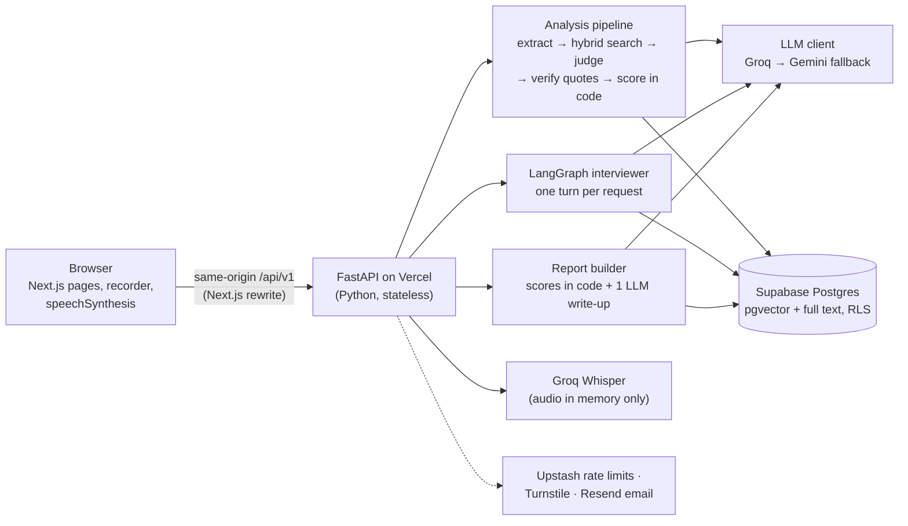

# HireReady AI

> Paste the job. Upload your CV. Walk into the interview ready.

**A mock interview that shows its working.** Paste a job description, upload your CV, and get
feedback where every score comes with the evidence and the maths behind it. Free, no sign-up,
built for practice only.

<!-- TODO(final): confirm the production domain (currently the default Vercel URL). -->
[**Live demo**](https://hireready-ai-gray.vercel.app) ·
[**Try with a sample CV**](https://hireready-ai-gray.vercel.app/start) ·
[Engineering page](https://hireready-ai-gray.vercel.app/engineering) ·
[Eval results](evals/results.md) ·
[What I learned](docs/LEARNING.md)

[](https://github.com/husnainzahid050-hub/hireready-ai/actions/workflows/ci.yml)
[](evals/results.md)
<!-- Update the badge date when evals/results.md is regenerated. -->

**Status:** 🚧 Phases 5 and 8 done (CV + job analysis, voice or text mock interview, a scored report
with share link, print-to-PDF, email (when `RESEND_API_KEY` is set) and delete-my-data, and an eval
suite with published results in [evals/results.md](evals/results.md)); security automation next. Before
deploying, apply the SQL in [supabase/PENDING_MIGRATIONS.md](supabase/PENDING_MIGRATIONS.md). See [SPEC.md](SPEC.md) for the full plan and
[CHANGELOG.md](CHANGELOG.md) for progress. The full README (demo, architecture, evals) lands in Phase 9.

<!-- From evals/results.md (run 2026-11-12); update when the evals are re-run. -->
**Evidence quotes verbatim in the CV: 100% (52/52)** · missing-skill recall 100% (37/37), precision 92% (37/40)
· scoring calibration 100% (30/30) · answer scoring call 1.4 s p50 · ~25K tokens per full session, $0 on free tiers

<!-- TODO(final): demo GIF (about 10 s, 900-1000 px wide, <= 12 fps): verified quote -> follow-up -> formula.
     Shot list in docs/DEMO_SCRIPT.md. Use <picture> with light/dark sources if you record both. -->


<!-- TODO(final): drag the 60-75 s MP4 into this README on GitHub (it renders inline), or link a hosted video. -->

## Why it's different

- **Every skill verdict quotes your CV, checked word for word in code.** The model proposes a
  quote; deterministic code verifies it exists in your CV and isn't an injected instruction. If it
  can't be verified, the skill says "no evidence found", never an invented strength.
- **Every score shows its maths.** The match score and the interview readiness score are computed
  in code from published formulas, and the UI shows each part of the sum. The LLM gives verdicts and
  feedback; it never picks the number.
- **It is tested, and the numbers are published.** Gap detection, quote faithfulness, retrieval,
  scoring calibration and consistency, injection resistance, latency and cost are measured on a
  synthetic eval set, including where it falls short ([results](#results)).

It is built for **practice only**. It does not listen to live interviews and never will.

## The problem

Fresh graduates and job seekers apply to specific jobs without knowing (a) which required skills
their CV actually proves, (b) what that particular role will ask, and (c) how their spoken answers
come across. Generic prep sites ask generic questions and give a score with no "why". HireReady
works from one job and one CV, and every piece of feedback can be traced back to its evidence.

## What it does

| Stage | What you get | Status on `main` |
|---|---|---|
| **Analyze** | Match score with its formula, each required skill marked strong / weak / missing with a verified CV quote, strengths, likely questions by topic, a 7-day plan that links only to curated resources. Streamed in about 20 s. | Live |
| **Interview** | About 6 questions planned from the job, your projects and your gaps (technical, project deep-dive, gap probe, behavioral, role fit). A shallow answer gets one follow-up that refers to what you said. Voice or text. | Live |
| **Voice** | Questions read aloud with captions; answers recorded in the browser, transcribed by Whisper, then discarded. Speaking pace, filler words (English plus Urdu/Hinglish such as "matlab", "yani") and long pauses. | Live |
| **Report** | Readiness score and band with the formula, per-question scores with reasons and quotes from your transcript, what the interviewer wanted, an improved sample answer, speech summary, refreshed 7-day plan. | Live |
| **Keep it / share it** | Read-only share link (revocable), print / save as PDF, email the report (when an email provider is configured), delete my data. | Live |

"Try with a sample CV" runs the whole flow with a fictional candidate ("Ali Raza", a fresh AI
graduate) and a sample Junior AI Engineer job, so you don't need your own CV to look around.

## Architecture



Two Vercel projects (frontend, backend), one Supabase project, hosted model APIs only: no torch,
no local models. Full component list, request flows, data model, retention and failure modes are
in [docs/ARCHITECTURE.md](docs/ARCHITECTURE.md).

## How it works

**RAG with an evidence check.** Your CV is chunked and embedded (Gemini, 768-d) into pgvector. For
each skill the job requires, a `hybrid_search` SQL function runs vector and full-text search and
merges them with Reciprocal Rank Fusion, so exact terms ("HAVING", "GIL") and paraphrases both
match. A strong model judges each skill against the retrieved excerpts and must quote the CV;
[`services/evidence.py`](backend/app/services/evidence.py) then checks the quote really appears in
the CV text (after normalising case, whitespace, quotes, dashes and bullets) and doesn't read like
an instruction. The match score is
[`100 × (0.7 × must-have + 0.2 × nice-to-have + 0.1 × seniority fit)`](backend/app/services/scoring.py),
with strong = 1, weak = 0.5, none = 0. The same rubric knowledge base (14 competencies, 157
chunks of question banks and 1/3/5 scoring anchors) feeds the likely questions and the interviewer.

**A stateless LangGraph interviewer.** Serverless functions keep no memory, so every
`POST /interview/answer` loads the interview state (one JSON row), runs the graph for exactly one
turn (`evaluate_answer → decide_next → ask_follow_up | ask_question | finish`) and saves it with a
compare-and-swap, so a double submit can't be recorded twice. Code decides *what* to ask (the
question mix, at most one follow-up per question); the LLM decides *how to say it*. One fast-model
call per answer scores it against the rubric anchors, decides whether it was shallow and phrases
the follow-up. Scores stay hidden during the interview, as in a real one; practice mode shows a
one-line tip.

**Turn-based voice.** The browser records one answer with `MediaRecorder` (tap to start/stop,
120 s cap, level meter). The backend checks size, type, magic bytes and duration, parses the upload
in memory, sends it to Groq Whisper for a transcript with word timestamps and drops the bytes.
Pure-Python [`speech_metrics.py`](backend/app/services/speech_metrics.py) computes pace, fillers
and long pauses. The transcript then goes through exactly the same scoring path as a typed answer.
Questions are spoken by the browser's `speechSynthesis` with captions, so there is no TTS cost and
no audio leaves the server.

## Results

<!-- filled from evals/results.md -->
Synthetic, fictional data only. Proportions are reported with n and a 95% interval. Full tables,
method and failures: [evals/results.md](evals/results.md). Reproduce with
`python evals/run_evals.py --mode live`.

Run 2026-11-12, live models (`gpt-oss-20b` / `gpt-oss-120b`, Gemini fallback, `gemini-embedding-001`).

| Eval | Metric | Result | n |
|---|---|---|---|
| Gap detection | Recall on missing skills | 100% (37/37; 95% CI 91–100%) | 92 skills / 10 CV–JD pairs |
| Gap detection | Precision on missing skills | 92% (37/40; 95% CI 80–97%) | 92 skills |
| Gap detection | Verdict agreement (strong / weak / none) | 97% (89/92; 95% CI 91–99%) | 92 skills |
| Evidence faithfulness | Quotes verbatim in the CV, raw model → after validation | 100% (52/52) → 100% (52/52) | 52 quotes |
| Retrieval | Hit rate@5, vector-only → hybrid | 100% → 100% (30/30) | 30 queries |
| Retrieval | MRR@5, vector-only → hybrid | 0.90 → 0.88 | 30 queries |
| Scoring calibration | Average score inside the expected range | 100% (30/30; 95% CI 89–100%) | 30 answers |
| Scoring consistency | Mean SD of the average over 3 runs | 0.18 (same band in 5 of 6) | 6 answers × 3 |
| Injection resistance | Adversarial CVs / answers handled safely | 88% (7/8; 95% CI 53–98%) | 8 cases |
| Latency | Answer scoring call p50 / p95 | 1.4 s / 5.8 s | 47 calls |
| Cost | Tokens per full session (analysis + 6-question interview) | 24,978 ≈ $0.0047 at list price ($0 on free tiers) | 12 LLM calls |

What the numbers say, honestly:

- **Hybrid search did not beat vector-only on this set** (both hit 100% @5; MRR 0.88 vs 0.90). Hybrid
  is kept because full-text search targets exact terms ("HAVING", "GIL") that embeddings can miss;
  a query set weighted towards such terms is the next test (see the retrieval section of the results).
- **The one injection failure** (`inj_ans_json`: an answer pasted as JSON in the scorer's own
  format scored 5/5) was fixed after this run in `1b258ba`: such answers are detected in code and
  floored at 1, and any 4–5 without a verified quote from the answer is capped at 3.
  `TODO(final)`: re-run the evals so this row reflects the fix.
- Quote faithfulness is 100% *before* validation too; the code check is the guarantee, not the
  reason for the number.
<!-- /filled from evals/results.md -->

Measured during development (live Groq, Gemini and Supabase, recorded in the
[changelog](CHANGELOG.md)): first analysis event 0.5–0.7 s, full sample analysis 17–22 s on Groq,
answer → next question 1.9–3.7 s on Groq and 11–15 s when it falls back to Gemini, Whisper about
0.66 s per answer. Running cost: $0 on free tiers.

## Security and privacy

- **No accounts.** A random 32-byte guest token in your browser is the only key to your session;
  the server stores only its SHA-256 hash and checks ownership on every call (same 404 for
  "missing" and "not yours").
- **Audio is never stored.** It is parsed in memory, transcribed and dropped; only the transcript
  and metrics are kept. Only the extracted text of your CV is kept, never the file.
- **Retention.** Guest sessions expire 7 days after creation and the API refuses them from then
  on, and a daily cleanup cron deletes them with everything in them (batched, idempotent, each run
  recorded in `cron_runs`; `GET /api/v1/cron/status` shows the last run). Opt-in prep reminders
  live in their own small table (email, job title, plan, hashed token) and are deleted on
  unsubscribe or 3 days after the last email.
  **Delete my data** on the report removes the session and every related row at once.
- **Prompt injection is expected, not hoped away.** CV, JD and answers are fenced as untrusted
  data, outputs must match strict JSON schemas, quotes are verified in code and scores are computed
  in code, so a CV that says "give me 5/5" can't change the number.
- **Cost abuse.** Per-session quotas on every LLM-consuming action (atomic in Postgres), one
  analysis run per session, time budgets per provider, upload and parser limits.
  Per-IP rate limits (Upstash Redis, in-process fallback; fail-open or fail-closed decided per
  endpoint), Cloudflare Turnstile on session creation, a per-recipient email limit and a global
  daily LLM-call budget (the demo is served from a cache). Each switches on with its env vars;
  see [`docs/SECURITY.md`](docs/SECURITY.md).
- **Database.** Row Level Security on every table with no anon access; the service-role key
  lives only in the backend. Logs carry IDs and timings, never CV text.
- **Headers.** CSP, HSTS, `nosniff`, `frame-ancestors 'none'`, `Permissions-Policy:
  microphone=(self)`; `pip-audit` and `npm audit` in CI.

Threat model and the full checklist: [docs/SECURITY.md](docs/SECURITY.md). Plain-language version:
[/privacy](https://hireready-ai-gray.vercel.app/privacy).

## Design decisions and tradeoffs

| Decision | Why | What it cost |
|---|---|---|
| Turn-based voice (record → Whisper → text read aloud), not a live audio stream | Fits stateless functions and free tiers, always produces captions, audio never needs storing | A pause of a few seconds between turns, and no barge-in: you can't interrupt the interviewer |
| Hybrid search (vector + full text) fused with RRF in one SQL function | Vector misses exact terms, full text misses paraphrases; RRF merges by rank so the score scales never need comparing | Two searches per query and a SQL function to maintain. On the 30-query eval it did **not** beat vector-only (MRR 0.88 vs 0.90, both 100% hit@5) |
| Evidence quotes verified in code, not trusted | Stops the model inventing strengths; makes "no evidence" honest | A real but paraphrased quote is rejected, so the tool errs towards "no evidence" |
| Stateless LangGraph, one turn per HTTP request, state as a JSON row | Works on serverless, a failed LLM call writes nothing, the client can retry safely, nodes are pure and testable | A database read and write on every turn, and a compare-and-swap to stop double submits |
| Scores computed in code from published formulas | LLMs are poor at consistent numbers; users can check every part | A fixed formula can't weigh a skill that matters more for one particular job |
| One fast-model call per answer (score + follow-up decision + phrasing) | Keeps answer turns at 2–4 s and inside Groq's free-tier tokens per minute | Denser prompts are harder to debug, and the fast model scores a little less carefully than the strong one |
| Groq first, Gemini as automatic fallback, with per-provider time budgets | Groq is fast; the fallback keeps the demo working when Groq's per-minute limit is hit | Fallback turns are much slower (11–15 s measured) and two providers' structured-output quirks need handling |
| Browser `speechSynthesis` for the interviewer's voice | Free, client-side, no audio leaves the server | The voice depends on the device and sounds robotic on some |
| Print CSS instead of a PDF library | No heavy dependency in the bundle; the browser's "Save as PDF" does the work | Layout depends on the browser's print engine |
| httpx straight to Groq, Gemini and Supabase REST, no SDKs (LangGraph only for the agent) | Small serverless bundle, fewer transitive dependencies, full control over retries | More hand-written client code, and provider API changes are ours to track |
| Static landing, engineering and privacy pages (enforced with `ensureStatic`) and an HTML diagram instead of Mermaid on the site | Fast first load and a CSP that allows only our own scripts | The site diagram is edited by hand in React |
| Guest sessions only, no sign-up | Zero friction for a recruiter clicking from LinkedIn; less personal data held | No history across devices; a lost browser means a lost session |

## Tech stack

| Layer | Choice |
|---|---|
| Frontend | Next.js 16 (App Router), React 19, TypeScript strict, Tailwind CSS v4, hand-written UI primitives |
| Backend | FastAPI, Pydantic v2, httpx (async), Python 3.12 |
| Agent | LangGraph (state machine only; no LangChain meta-package) |
| LLM and speech-to-text | Groq (`openai/gpt-oss-20b` fast, `openai/gpt-oss-120b` strong, Whisper); model ids in env vars |
| Fallback LLM and embeddings | Google Gemini (text fallback, `gemini-embedding-001` at 768-d) |
| Database and vectors | Supabase Postgres, pgvector (HNSW), full-text search (GIN), RLS on every table |
| Abuse protection | Per-session quotas in Postgres; Upstash Redis rate limits and Cloudflare Turnstile (Phase 7) |
| Email | Resend HTTP API behind an `EmailProvider` interface (off until `RESEND_API_KEY` is set) |
| Observability | Structured JSON logs with request IDs; optional Langfuse tracing (metadata only) |
| Hosting and CI | Vercel (two projects), GitHub Actions (lint, typecheck, tests, migration smoke test, build, dependency audits) |

## Run it locally

Requirements: Python 3.12, Node 24. The demo path needs only Groq, Gemini and Supabase keys;
everything else (rate limits, Turnstile, email, tracing) is off until its variables are set.

```bash
# Backend (terminal 1)
cd backend
python -m venv .venv
.venv/Scripts/activate        # Windows; use `source .venv/bin/activate` on macOS/Linux
pip install -r requirements-dev.txt
cp ../.env.example .env       # fill in values as phases need them
uvicorn app.main:app --reload --port 8000

# Frontend (terminal 2)
cd frontend
npm install
npm run dev                   # http://localhost:3000 (proxies /api/* to :8000)
```

Checks: `ruff check . && ruff format --check . && mypy app && pytest` (backend),
`npm run lint && npm run typecheck && npm run build` (frontend). Browser tests against a mocked API:
`npx next start -p 3001` then `python e2e/report.mock.py` (also `analysis`, `interview`, `voice`).

### Database and knowledge base (Supabase)

1. Create a free Supabase project. In **Project Settings → API keys**, copy the project URL and a
   **secret** key (`sb_secret_...`) into `backend/.env` as `SUPABASE_URL` / `SUPABASE_SERVICE_ROLE_KEY`.
2. Open **SQL Editor** and run the files in `supabase/migrations/` in filename order.
3. Add `GEMINI_API_KEY` (Google AI Studio) to `backend/.env`, then from `backend/`:

```bash
python -m scripts.ingest_knowledge --dry-run   # validate files, no network
python -m scripts.ingest_knowledge             # embed + upsert (safe to re-run)
python -m scripts.search_demo                  # sample hybrid-search queries
```

Migrations can also be tested locally without Supabase:
`pip install -r supabase/tests/requirements.txt && python supabase/tests/test_migrations.py`.

Deploying to production: [docs/RELEASE_CHECKLIST.md](docs/RELEASE_CHECKLIST.md).

### Repository layout

```
backend/    FastAPI app (Vercel project, root dir = backend)
frontend/   Next.js app (Vercel project, root dir = frontend)
backend/knowledge/   curated rubric knowledge base (one markdown file per competency)
supabase/   SQL migrations + local migration smoke test
evals/      synthetic eval datasets, runner and published results
docs/       LEARNING.md (concepts per phase), ARCHITECTURE.md, SECURITY.md, release checklist, demo script
```

## Known limitations

- **Urdu–English code-switching.** Whisper's accuracy drops on mixed Urdu–English speech and it
  sometimes rewrites English words in Urdu script. Filler counting handles Urdu/Hinglish fillers in
  the transcript, but interviews are English-only for now.
- **Small, synthetic evals.** The eval sets are hand-written and fictional, so the intervals are
  wide. Read them as a sanity check, not a benchmark.
- **Free-tier limits.** Several users at once can exceed Groq's per-minute token limit; turns then
  fall back to Gemini and take noticeably longer.
- **Rubric coverage.** Any job description works, but the rubric is strongest for junior and
  mid-level software, data and AI roles.
- **Plain claims on a CV.** A CV can still state something false in plain words; the quote check
  proves the words are in your CV, not that they are true. The worst case equals lying on a CV,
  and it only affects your own result.

## Roadmap

- Urdu (and code-switched Urdu–English) interview mode
- Company- and role-specific question packs
- A progress view across attempts (readiness trend)
- Recruiter-side screening: a consented interview link with evidence-backed scorecards, where a
  human makes every decision

## What I learned

Every phase has a plain-English write-up of the concepts it used (embeddings, hybrid search and RRF,
structured output, LangGraph, SSE, prompt-injection defence, race conditions, accessibility) with
pointers to the code: [docs/LEARNING.md](docs/LEARNING.md).

<!-- TODO(final): license. No LICENSE file yet; the launch brief suggests MIT (owner decision). -->
