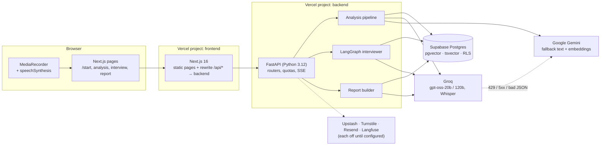
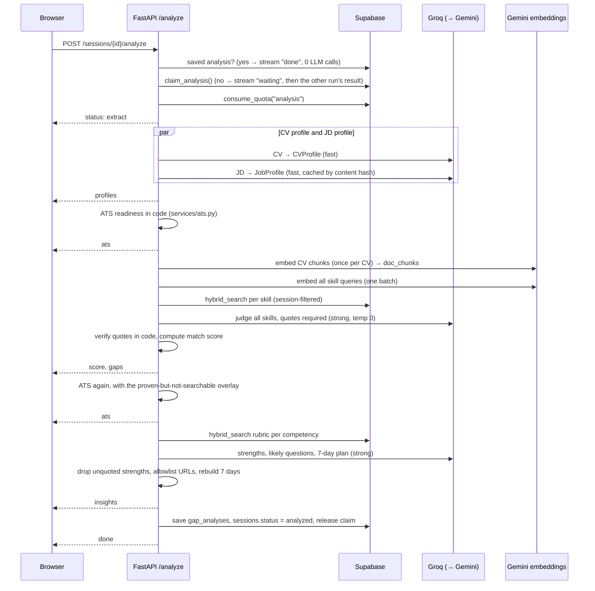

# Architecture

How HireReady AI is put together: components, the four main request flows, the data model,
retention, how it is deployed, and what happens when something fails. Written against the code on
`main` (Phases 0-8 merged).

## 1. Components



| Component | Where | Responsibility |
|---|---|---|
| Next.js frontend | `frontend/` | Static landing / engineering / privacy pages (`ensureStatic`), the app pages, and a server-side rewrite of `/api/*` to the backend so the browser only ever talks to one origin. Security headers in `next.config.ts`. |
| API client | `frontend/lib/api.ts`, `lib/types.ts` | Typed calls mirroring the backend contract, SSE parsing, guest token in `localStorage`. |
| Recorder | `frontend/components/interview/voice/` | Lazy-loaded `MediaRecorder` (webm/opus), 120 s auto-stop, level meter via `requestAnimationFrame`, mic released on stop/unmount. |
| FastAPI app | `backend/app/main.py` | Request IDs, structured logs, CORS allowlist, body-size limit (4.5 MB), security headers, error envelope. |
| Routers | `backend/app/routers/` | `health`, `sessions` (create, documents, analyze, analysis), `interview` (start, get, answer). `report` (report, share, email, delete). `reminders` (token links, one-click unsubscribe, opt-in after the report), `cron` (cleanup, reminders, public status), `health/client-ip`. |
| Analysis pipeline | `backend/app/services/analysis.py` | Extraction, CV indexing, hybrid retrieval, evidence judging, quote verification, match score, insights. Streamed as SSE. |
| Interviewer agent | `backend/app/agents/interviewer/` | LangGraph state machine: `plan_interview`, `ask_question`, `evaluate_answer`, `decide_next`, `ask_follow_up`, `finish`; tools `search_cv`, `search_rubric`, `score_answer`. |
| Interview service | `backend/app/services/interview.py` | Load state → one graph turn → persist with compare-and-swap → API response. |
| Voice | `backend/app/services/voice_answer.py`, `stt.py`, `audio_duration.py`, `speech_metrics.py` | In-memory multipart parsing, audio validation, Groq Whisper, speech metrics, then the same `submit_answer` as text. |
| LLM client | `backend/app/services/llm.py` | Strict JSON-schema output on Groq, Pydantic validation, retry, Gemini fallback, per-provider time budget, `wrap_untrusted` fences. |
| Retrieval | `backend/app/services/retrieval.py` + `hybrid_search` SQL | Embeds queries (Gemini, 768-d) and calls the RRF function with a session or rubric filter. |
| Scoring | `backend/app/services/scoring.py`, `evidence.py` | Deterministic match score; quote verification and normalisation. |
| Guards | `backend/app/core/` | `security.py` (guest tokens), `quotas.py`, `rate_limit.py`, `turnstile.py`, `injection.py`, `body_limit.py`, `headers.py`, `sse.py` (budgets + "slow" notices). |
| Knowledge base | `backend/knowledge/*.md` → `knowledge_chunks` | 14 competency files, 157 chunks: what's evaluated, question banks, 1/3/5 anchors, curated resource URLs. Ingested by `scripts/ingest_knowledge.py` (idempotent by content hash). |
| Report builder | `backend/app/services/report.py`, `routers/report.py`, `services/email.py` | Scores in code, one strong-model write-up, share links, email via Resend, delete-my-data. |
| Tracing | `backend/app/core/tracing.py` | Per-call usage records; optional Langfuse export over OTLP/HTTP, metadata only, never prompt or output text. |
| Evals | `evals/` | Synthetic datasets, `run_evals.py`, `results.md` / `results.json`, manual GitHub Actions workflow. |

## 2. Request flows

All session-scoped endpoints take the guest token (`X-Guest-Token`), hash it, and load the session
with `get_owned_session`, which checks ownership and expiry and returns the same 404 for "missing"
and "not yours". LLM-consuming endpoints then take a per-IP rate-limit slot (no-op until Upstash
is configured) and a per-session quota unit (atomic `consume_quota()` in Postgres), **after** the
cheap checks, so rejected requests cost nothing.

### 2.1 Session creation and upload

1. `POST /api/v1/sessions` (consent required; `?demo=true` preloads the fictional "Ali Raza" CV and
   a Junior AI Engineer JD from `backend/app/demo/samples.py`). Turnstile is verified here when
   `TURNSTILE_SECRET_KEY` is set (widget on `/start`, invisible "interaction-only" on the demo
   button; the CSP allows Cloudflare only on `/`, `/start`, `/r/*`). Returns
   `session_id` and a random 32-byte guest token; only its SHA-256 is stored.
2. `POST /sessions/{id}/documents` (multipart CV + JD text). PDF/DOCX only, 2 MB, 5 pages, MIME
   must match magic bytes, pypdf/DOCX bomb limits, parsing in a worker thread with a 15 s timeout.
   Only the extracted text is stored (30k chars max), never the file. DOCX header, footer and
   text-box text is kept too (python-docx's paragraphs skip it). While parsing, layout signals for
   the ATS check are summarised (`services/layout.py`: pages, characters and images per page, PDF
   side-by-side columns from text positions, white text, DOCX tables / text boxes / Word columns /
   header-footer text, generic file name) and stored in `documents.structured.ats_file`.

### 2.2 Analysis (SSE)



- **Events:** `status`, `profiles`, `ats`, `score`, `gaps`, `ats` (again), `insights`, `done`, `error`, plus `slow`
  after 15 s without progress or as soon as the LLM falls back to Gemini.
- **Budget:** 50 s for the whole stream (`ANALYSIS_BUDGET_S`, inside the 60 s `maxDuration` in
  `backend/vercel.json`), at most 25 s per provider including retries. Over budget →
  `analysis_timeout`. The page shows Try again if the stream closes without `done` or `error`.
- **ATS readiness:** `ATS = 100 × (0.40 R + 0.45 K + 0.15 C)` from readability checks R1–R8,
  keyword coverage K1–K5 (`knowledge/aliases.yaml`) and content checks C1–C6, capped at 40 when the
  text can't be read. Pure code (~0.1 s), deterministic; stored in `gap_analyses.breakdown.ats`.
  Analyses saved before it existed (and demo-cache copies) get it computed on read and saved back.
- **Cost:** 3–4 LLM calls per fresh analysis (the JD profile is cached by content hash). Re-opening
  a saved analysis is a database read.

### 2.3 Interview turn (text)

```
START --(event=start)--> plan_interview --> ask_question --> END
START --(event=answer)-> evaluate_answer --> decide_next --+--> ask_follow_up --> END
                                                           +--> ask_question  --> END
                                                           +--> finish        --> END
```

1. `POST /interview/start` (idempotent: an existing state is returned, never re-planned or
   re-charged). Code picks the question mix from `interview_type` and difficulty (2 technical,
   1 project deep-dive, 1 gap probe, 1 behavioral, 1 role fit for `mixed`); rubric chunks and 1/3/5
   anchors are prefetched; **one** strong-model call phrases all questions.
2. `POST /interview/answer` with `{question_id, text}`:
   - Load `interview_state` and the CV/JD profiles + gaps in parallel.
   - Check the question is the one waiting (`wrong_question`, `interview_completed`), then charge.
   - Run one graph turn. **One** fast-model call scores the answer on the SPEC 6.5 dimensions
     (string enums "1"–"5", quotes checked against the transcript), signals whether it was shallow,
     and phrases the follow-up. At most one follow-up per question (`decide_next`).
   - Nodes never write to the database. The service inserts the new question/answer rows, then
     commits the state with a compare-and-swap (`state->current->>id` must still be the answered
     question). The loser of a double submit removes its rows and gets 409 `turn_conflict`.
3. Scores are never sent during the interview. Practice mode returns a one-line summary and tip.
4. `finish` marks the interview completed; the report is generated on request (2.5).

### 2.4 Voice answer

1. The browser records one answer (tap to start/stop, 120 s auto-stop) and posts multipart
   `{question_id, audio}` to the same `/interview/answer` endpoint.
2. `read_audio_form` parses the body **in memory** (the multipart spool size is raised to the body
   limit, so it never rolls over to a temp file), 3 MB cap.
3. `validate_audio`: MIME + magic bytes, container duration where the header has one.
4. The pending question is checked and the "over-long recording" strike count read; after 2 strikes
   the session can only type (a crafted file can hide its real length from the header check).
5. Charge, then Groq Whisper (`verbose_json`, segment + word timestamps, a disfluent prompt so
   fillers are kept). The bytes are dropped right after.
6. Whisper's reported duration over 120 s (plus tolerance) → a strike and 422 `audio_too_long`.
   Empty transcript → 422 `no_speech`. Provider failure → 503 `stt_unavailable` (retry without
   re-recording).
7. `compute_metrics`: words per minute over speaking time, fillers (English + Urdu/Hinglish, with
   context rules for "like", "you know", "kind of"), pauses over 2 s.
8. The transcript (5,000 chars max) goes into the same `submit_answer` as typed text, so it is
   fenced as `<transcript>` and scored identically. Metrics are saved on the `answers` row.
9. The next question comes back as text; the browser speaks it with `speechSynthesis` and shows
   the caption (mute persisted, replay button).

### 2.5 Report

Merged with Phase 5 (`backend/app/services/report.py`, `routers/report.py`).

1. `POST /sessions/{id}/report` (SSE). Interview must be completed. A cached report is streamed
   back for free. Otherwise the `reports` row itself is the lock: a placeholder insert without
   upsert, so a second caller waits for the first run.
2. Deterministic part, no LLM: per-answer weighted dimensions (relevance 0.20, technical accuracy
   0.25, depth 0.25, structure 0.15, communication 0.15; N/A renormalised), a question with a
   follow-up = 70% main + 30% follow-up, **readiness = 0.75 × interview score + 0.25 × CV match**,
   band, answer levels, speech summary. Streamed as `overview` so the page renders before the
   write-up.
3. One strong-model call (temperature 0.1): employer view, themes, refreshed 7-day plan. Guards in
   code: flag quotes must exist in the referenced transcript, the verdict may move at most one step
   from what the score implies, plan URLs must be in the curated catalog. On LLM failure a
   deterministic fallback report is built, so a finished interview always gets a report.
4. 55 s budget. Then `done`.
5. Share: `POST /report/share` creates or revokes a 256-bit token; `GET /reports/shared/{token}`
   returns a redacted copy (no raw CV text, emails and phone numbers masked) with `noindex` and
   `no-store`, dead once the session expires.
6. Email: `POST /sessions/{id}/email` via Resend's HTTP API (idempotency key per report and
   recipient hash). Disabled (503 `email_not_configured`) until `RESEND_API_KEY` and `EMAIL_FROM`
   are set. A short summary plus link, never transcripts.
7. Delete: `DELETE /sessions/{id}` removes the session; every table cascades from `sessions`.

### 2.6 Scheduled jobs, reminders and the webhook (Phase 7)

`backend/vercel.json` has two Vercel Cron entries (Hobby: once a day, about ±1 h precision):

| Schedule (UTC) | Endpoint | What it does |
|---|---|---|
| `0 2 * * *` | `GET /api/v1/cron/cleanup` | `cleanup_expired(200)` in batches (≤ 10 per run, 40 s budget): deletes sessions past `expires_at` (every child table cascades), first detaching their reminder rows; deletes expired reminders and `cron_runs` older than 30 days; records each batch in `cron_runs` and returns the counts |
| `0 3 * * *` | `GET /api/v1/cron/reminders` | Sends the next plan day to every due ACTIVE reminder, up to `REMINDER_DAILY_CAP` (250); pauses a plan after 3 sent days without a "Mark done" click; stops after day 7 |

Both require `Authorization: Bearer <CRON_SECRET>` (Vercel sends it when the env var is set),
compared in constant time; unset = 503, wrong = 401. Both are idempotent: the reminder day moves
with a compare-and-swap before the email goes out, and Resend's `Idempotency-Key` backs it up.
`GET /api/v1/cron/status` (public, no IDs) shows when each job last ran.

Reminders (`backend/app/services/reminders.py`): opt-in at `/start` ("Send me 7 daily prep
emails", separate from "Email me my report") or `POST /sessions/{id}/reminders`. When the report is
built, a PENDING row is created and ONE confirmation email is sent (double opt-in); Day 1 goes out
when the person presses "Start my 7-day plan" on `/reminders/{token}`. Every email has
`List-Unsubscribe` + `List-Unsubscribe-Post: List-Unsubscribe=One-Click` (RFC 8058) and a footer
link; `POST /api/v1/unsubscribe/{token}` deletes the row with no login and no confirmation step,
while GET never changes anything (mail scanners prefetch links).

After a fresh report (`backend/app/services/automation.py`, started on the `done` event so it can't
delay or fail the report): the `report.completed` webhook (Standard Webhooks: `webhook-id`,
`webhook-timestamp`, `webhook-signature: v1,<base64 HMAC-SHA256>`; 5 s per attempt, 3 attempts,
minimal payload without CV text, transcripts or email), the report email if opted in, and the
reminder confirmation if opted in.

## 3. Data model

All tables live in `public`, have RLS enabled with **no policies**, and have every grant revoked
from `anon` and `authenticated`. Only the backend's service-role key can read or write. SQL
functions are executable by `service_role` only. Everything cascades from `sessions`.

| Table | Key columns | Written by |
|---|---|---|
| `sessions` | `id`, `guest_token_hash`, `status` (created / analyzed / interviewing / completed), `mode`, `difficulty`, `interview_type`, `email_opt_in`, `email`, `is_demo`, `analysis_started_at` (claim), `created_at`, `expires_at` (default now + 7 days) | create, analyze, interview |
| `documents` | `session_id`, `kind` (cv / jd, unique per session), `raw_text` (≤ 60k), `structured` (profile JSON; a CV's also holds `ats_file` layout signals from upload), `content_hash` | upload, analyze |
| `doc_chunks` | `document_id`, `chunk_index`, `content`, `embedding vector(768)` (HNSW cosine), `tsv` (generated, GIN) | analyze (once per CV) |
| `knowledge_chunks` | `source_file`, `competency`, `level` (all / junior / mid), `content`, `content_hash` (unique), `embedding`, `tsv` | `scripts/ingest_knowledge.py` |
| `gap_analyses` | `session_id` (pk), `match_score`, `breakdown` (also `role_title` and the `ats` report), `gaps`, `strengths`, `likely_questions`, `prep_plan` (jsonb) | analyze |
| `questions` | `session_id`, `order_index`, `type` (technical / project / gap_probe / behavioral / role_fit / follow_up), `competency`, `text`, `parent_question_id`, `rubric_chunk_ids` | interview |
| `answers` | `question_id`, `transcript` (≤ 10k), `duration_seconds`, `words_per_minute`, `filler_count`, `filler_breakdown`, `long_pauses`, `scores`, `feedback` | interview |
| `interview_state` | `session_id` (pk), `state` (the whole LangGraph state as JSON), `updated_at` | interview (compare-and-swap) |
| `reports` | `session_id` (pk), `report` (jsonb; also the generation lock), `share_token` (unique), `emailed_at` | report |
| `reminders` | `id`, `session_id` (nullable: detached by cleanup), `email`, `email_hash`, `role_title`, `plan` (7 days), `token_nonce` + `token_hash` (token = HMAC of the nonce; only its hash stored), `status` (pending / active / paused / finished), `day_index`, `last_click_day`, `next_send_date`, `expires_at` (own lifetime) | report automation, reminder links, reminders cron |
| `cron_runs` | `name`, `ran_at`, `stats` (counts) | cleanup function, reminders cron |
| `session_usage` | `(session_id, action)` pk, `count` | `consume_quota()` |

SQL functions: `hybrid_search(query_embedding, query_text, match_count, filter)` (vector + full-text
fused with RRF, `1/(k + rank)`, k = 50; raises if a CV search has no `session_id`),
`consume_quota(session_id, action, limit)` (one atomic upsert), `claim_analysis(session_id,
stale_seconds)` (one conditional update), `cleanup_expired(batch)` (batched deletion, returns
counts) and `copy_demo_analysis(session_id)` (a demo session reuses an earlier demo session's
analysis, chunks and profiles for the same CV + JD: no LLM calls).

Per-session quotas (`backend/app/core/quotas.py`): upload 5, analysis 3, interview start 3,
answers 40, report 3, email 3, over-long audio strikes 2.

Per-IP rate limits (`backend/app/core/rate_limit.py`, fixed window per hashed IP; Upstash Redis
when configured, otherwise an in-process window): session create 10/h, upload 10/h, analyze 10/h,
interview start 3/day, answers 30/h, report 10/h, email 5/h, plus 3 emails per recipient per day
across all sessions. The client IP comes from `X-HireReady-Client-IP`, set by `frontend/proxy.ts`
and trusted only with `CLIENT_IP_HEADER_SECRET`. A global daily LLM-call budget
(`backend/app/core/budget.py`, `LLM_DAILY_BUDGET`) pauses fresh demo work at 80% and all fresh LLM
work at 100% (503 with `Retry-After` until 00:00 UTC).

## 4. Retention

| Data | Kept for | How it goes away |
|---|---|---|
| Audio | Never stored | Parsed in memory, sent to Whisper, dropped when the request ends |
| CV file | Never stored | Only the extracted text is kept |
| CV/JD text, profiles, chunks, analysis, questions, answers, interview state, report | Until the session expires (7 days after creation) or is deleted | Expiry is enforced on every read today (the API refuses expired sessions, and shared links die with them). Physical deletion: daily cleanup cron (02:00 UTC), so at most about a day after expiry. "Delete my data" on the report removes everything at once |
| Knowledge base | Permanent | Curated content, no user data |
| Logs (Vercel) | Vercel's log retention | IDs, timings and error types only; emails masked, long strings truncated, no LLM output |
| Traces (Langfuse, optional) | Langfuse's retention | Metadata only (model, tokens, latency, request id) |
| Data sent to providers | Their terms | Groq, Google Gemini, Supabase, Vercel (and Resend for email) process data to produce the feedback; listed on `/privacy` |
| Reminder row (email, job title, 7 plan days, token hash) | Pending: 3 days to confirm. Active: until 3 days after the last email | Deleted at once on unsubscribe or "Delete my data"; otherwise by the cleanup cron when it expires. Survives the session's 7-day expiry on purpose (the plan starts after the interview) |

## 5. Deployment topology

```
                       ┌──────────────────────────── Vercel ────────────────────────────┐
Browser ── HTTPS ──▶   │ frontend project (root: frontend/)                              │
                       │   static pages from the CDN, app pages, /api/* rewrite ─────┐   │
                       │                                                             ▼   │
                       │ backend project (root: backend/)  FastAPI, Fluid compute,       │
                       │   maxDuration 60 s, 4.5 MB request body, cron (Phase 7)         │
                       └───────────────┬───────────────────────────┬────────────────────┘
                                       │ REST (service role)       │ HTTPS
                                       ▼                           ▼
                             Supabase Postgres            Groq · Gemini · Upstash ·
                             (pgvector, RLS)              Turnstile · Resend · Langfuse
```

- **Two Vercel projects** from one repo, root directories `frontend/` and `backend/`. Vercel
  auto-detects the FastAPI `app` in `backend/app/main.py` (no `api/index.py`). Verified limits
  (Nov 2026, Hobby, Fluid compute): 500 MB Python bundle, 300 s max duration (we set 60 s), 4.5 MB
  request/response body, cron at most once per day.
- The frontend's `BACKEND_URL` is server-side only, so the backend URL never ships to the browser.
  The backend URL is still public, so every control lives in the backend, not in the proxy.
- `ALLOWED_ORIGINS` on the backend lists the frontend origin (CORS mostly matters for local dev).
- In production (`VERCEL_ENV=production` or `APP_ENV=production`) the OpenAPI docs are hidden.
- Environment variables per project and the exact deploy order: [RELEASE_CHECKLIST.md](RELEASE_CHECKLIST.md).

## 6. Failure modes and fallbacks

| Failure | What happens | Where |
|---|---|---|
| Groq 429 (per-minute token limit), 5xx, network error or invalid JSON | One quick retry, then the same request goes to Gemini with the same schema. The stream sends `slow` so the user knows. Measured: answer turns 11–15 s on Gemini vs 2–4 s on Groq | `services/llm.py` |
| Both providers fail | Analysis: `error` event with `ai_unavailable`, claim released, Try again. Interview: 503 `ai_unavailable`, **nothing written**, the typed answer is kept in the browser and can be resent. Report: deterministic fallback report | `llm.py`, `services/interview.py`, `services/report.py` |
| A provider hangs | Each provider has 25 s including retries; the analysis has a 50 s budget and the report 55 s, inside Vercel's 60 s | `llm.py`, `core/sse.py` |
| Function killed mid-run (timeout, crash) | The analysis claim and the report placeholder expire after 120 s, so the next request can run. The browser sees a stream that closed without `done` and offers Try again | `services/analysis.py`, `services/report.py` |
| Two tabs / double click | Analysis: the second caller streams `waiting`, then the first result. Interview start: idempotent. Answers: compare-and-swap, the loser gets 409 `turn_conflict` | `analysis.py`, `interview.py` |
| Whisper fails | 503 `stt_unavailable`; the recording stays in the browser for a retry upload | `services/stt.py`, recorder |
| Mic denied or no `MediaRecorder` | The interview switches to typing; text mode is a full alternative | `components/interview/voice/` |
| Upstash unreachable | Rate limiter **fails open** (per-session quotas in Postgres still apply) | `core/rate_limit.py` |
| Turnstile unreachable or token invalid | **Fails closed**: 403 `bot_check_failed` on session creation | `core/turnstile.py` |
| Quota migration missing | Upload, analyze and interview fail closed with 500: apply `supabase/PENDING_MIGRATIONS.md` before deploying | `core/quotas.py` |
| Email provider not configured or failing | 503 `email_not_configured` / error; the button is shown disabled with an explanation | `services/email.py` |
| Langfuse misconfigured or down | Tracing errors are swallowed; requests never wait for export | `core/tracing.py` |
| Malicious upload (zip/PDF bomb, wrong type) | 400 / 413 / 422 before any LLM call | `services/parsing.py`, `core/body_limit.py` |
| Prompt injection in CV, JD or answers | Fenced as data, strict schemas, quotes verified, scores in code; worst case equals a false claim on your own CV | `llm.py`, `evidence.py`, `core/injection.py` |

Known open risks are tracked in [SECURITY.md](SECURITY.md) ("Controls pending") and the changelog.
